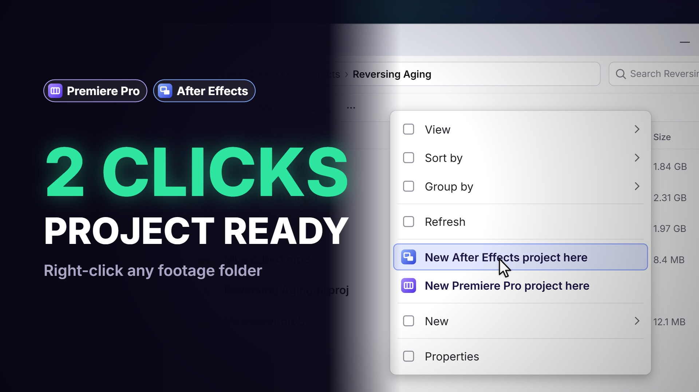
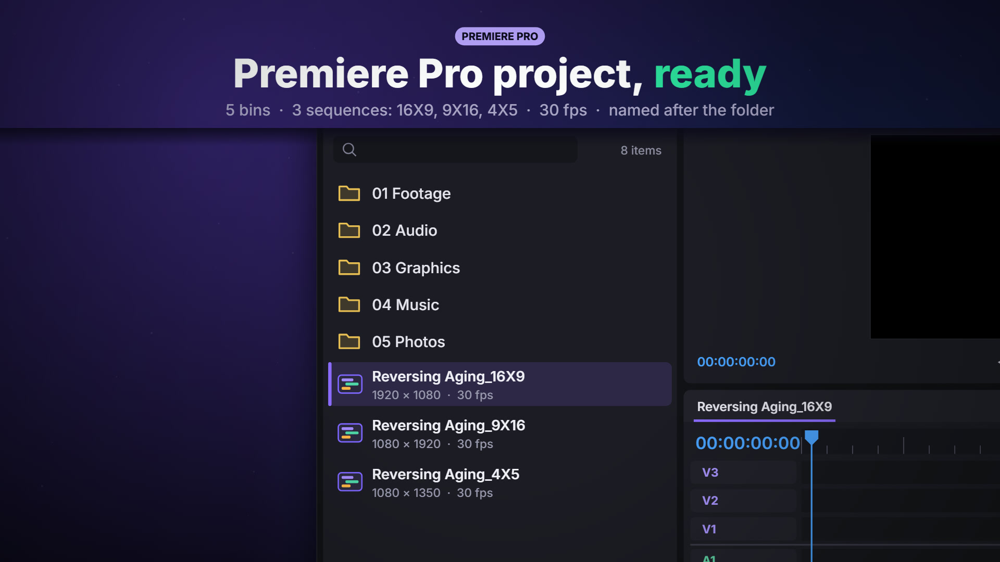
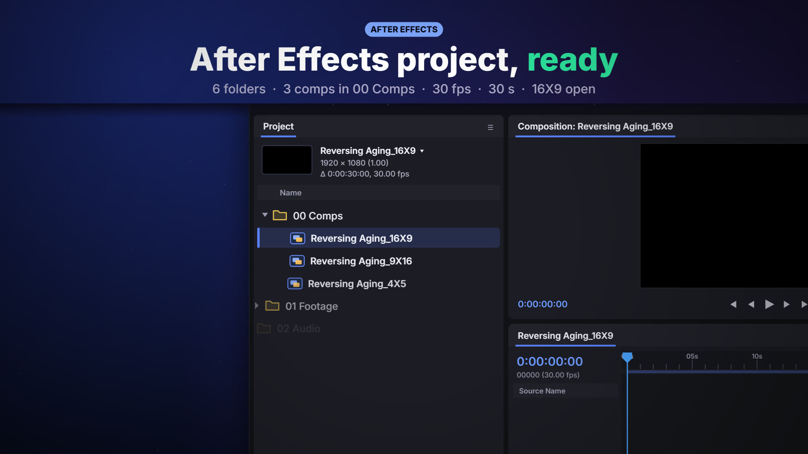
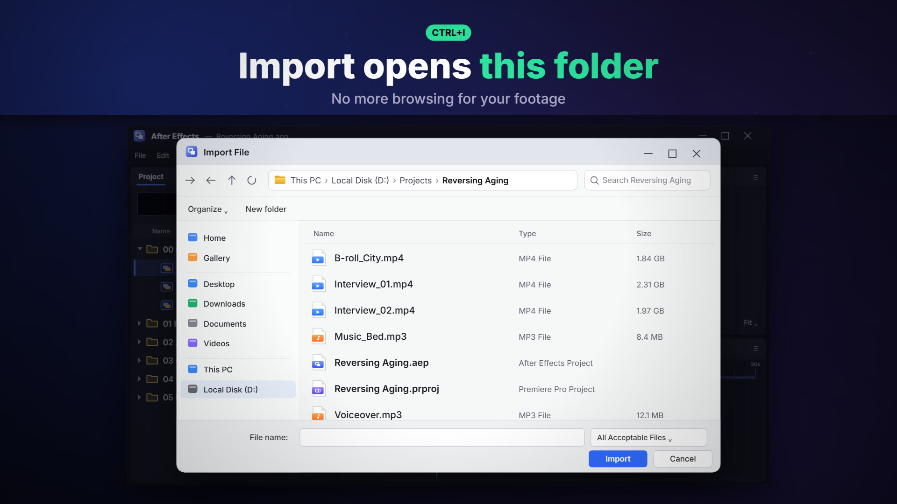

<div align="center">

# LazyProjectHere

**Right-click any folder. Get a ready After Effects or Premiere Pro project named after it.**

A small right-click tool for video editors and motion designers. Windows, and [Mac (beta)](#mac-beta).

[বাংলায় পড়ুন](README.bn.md) · [Download](https://github.com/raisulsohan/LazyProjectHere/releases/latest) · [▶ Watch the 20-second demo](https://raisulsohan.github.io/LazyProjectHere/)


<a href="https://raisulsohan.github.io/LazyProjectHere/"></a>

**[▶ Watch the demo with sound](https://raisulsohan.github.io/LazyProjectHere/)** (20 seconds, plays in the browser)

</div>

## See it

| Premiere Pro | After Effects |
|---|---|
|  |  |
| 5 bins, 3 sequences named after the folder | `00 Comps` with 3 comps, 16X9 open |



*Ctrl+I opens in the footage folder, so you do not have to browse for it.*

## What it does

Right-click inside a folder (or on a folder icon, or on a drive) and choose one of two entries:

- **New After Effects project here**
- **New Premiere Pro project here**

For a folder called `My Video` you get `My Video.aep` or `My Video.prproj` in that folder, with:

| Comp / sequence | Size | |
|---|---|---|
| `My Video_16X9` | 1920x1080 | open and ready |
| `My Video_9X16` | 1080x1920 | |
| `My Video_4X5` | 1080x1350 | |

All three are 30 fps. The project opens in the app, and **Import (Ctrl+I) opens in that folder**.

An existing project is never overwritten: the new one gets `_2`, `_3` ... at the end.

### After Effects

- Comps: 30 seconds, black background, square pixels.
- Folders: `00 Comps` (the three comps), `01 Footage`, `02 Audio`, `03 Graphics`, `04 Music`, `05 Photos`.
- **Your New Project Template is used** (Preferences > New Project). Its folders stay, the comps go into the folder that holds the template's comp, and empty template comps are replaced by the three new ones.
- Works with After Effects open or closed. With unsaved changes, After Effects asks to save first. Cancel changes nothing.
- The Import folder is set even while After Effects is open.
- Comp length, frame rate and colour: the `Comp settings` lines at the top of `AE\AEHere.ps1`.

### Premiere Pro

- Bins: `01 Footage`, `02 Audio`, `03 Graphics`, `04 Music`, `05 Photos`.
- The Import folder is set only while Premiere Pro is closed (Premiere rewrites its prefs on exit).
- Own template: save a blank project as `template.prproj` in the `Premiere` folder of the install.

## Install

1. Download `LazyProjectHere.zip` from [Releases](https://github.com/raisulsohan/LazyProjectHere/releases/latest) and extract it.
2. Double-click `Install.cmd`.
3. When the window shows "Installed to", press any key.

It installs to `%USERPROFILE%\Tools\LazyProjectHere` for the current user, with no admin rights. An entry is added only for an app that is installed. Old one-app versions (`Tools\PremiereHere`, `Tools\AEHere`) are removed, and your own `template.prproj` is kept.

On Windows 11 the entries can be under **Show more options** (or press Shift + right-click).

To remove: double-click `Uninstall.cmd`. Projects you made stay.

## Mac (beta)

> [!WARNING]
> The Mac version is a **beta: nobody has run it on a Mac yet.** Please [open an issue](https://github.com/raisulsohan/LazyProjectHere/issues) with what you see, and the lines from `~/Library/Logs/LazyProjectHere.log`.

1. Download `LazyProjectHere-mac.zip` from [Releases](https://github.com/raisulsohan/LazyProjectHere/releases/latest) and extract it.
2. Double-click `Install.command`. If macOS says it "can't be opened", go to **System Settings > Privacy & Security** and click **Open Anyway**, or run it from Terminal: `bash /path/to/Install.command`.
3. In Finder, right-click a folder (or any file in it) > **Quick Actions** > **New After Effects project here** / **New Premiere Pro project here**.
4. The first time, macOS asks to let it control After Effects: click **OK**.

The same project is made as on Windows (names, sizes, 30 fps, folders, your After Effects template). It installs to `~/Library/Application Support/LazyProjectHere` and `~/Library/Services`, with no admin password. No Quick Action? Turn it on in **System Settings > General > Login Items & Extensions > Finder**. To remove: double-click `Uninstall.command`.

Not known yet on the Mac: whether After Effects' Import dialog opens in the folder. Premiere Pro's Import folder is set while Premiere Pro is closed, as on Windows.

## How it works

- `AE\AEHere.ps1` finds `AfterFX.exe`, starts After Effects if needed and sends it `AE\AEHere.jsx` with `AfterFX.exe -s`. The script builds and saves the project inside After Effects.
- After Effects 2027's Import dialog keeps its last folder in Windows' own file-dialog memory (`ComDlg32\LastVisitedPidlMRU`, under the dialog's ID), not in the After Effects prefs. The tool writes the folder there, and Windows reads it every time the dialog opens.
- `Premiere\PremiereHere.ps1` writes the `.prproj` (gzipped XML) from `template.prproj`, adds the 4:5 sequence, renames the sequences and sets `be.prefs.last.used.directory` in the Premiere prefs.
- Small `.vbs` launchers start PowerShell without a console window. Errors show in a message box and in `AEHere.log` / `PremiereHere.log`.
- Mac: `mac/Install.command` writes two Automator Quick Actions that run `mac/lazyprojecthere.js` (JavaScript for Automation). For After Effects it sends the same `AEHere.jsx` with AppleScript `DoScript`. For Premiere Pro it uses `mac/template.prproj`, which already holds the three sequences.

## Build the zips

```bash
python build-zip.py
```

It writes `LazyProjectHere.zip` (Windows) and `LazyProjectHere-mac.zip` (Mac, with runnable `.command` files) next to this folder.

Tested on Windows 11 with After Effects 2027 (27.0) and Premiere Pro 2027 (27.0). The Mac version is not tested yet.

## License

[MIT](LICENSE)
